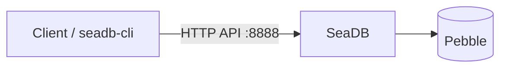

# Overview

This guide covers single-node deployment of SeaDB using **Pebble** as the embedded key-value store. You deploy one SeaDB service with persistent local storage and access the REST API directly on port `8888`.

## Single-node deployment

SeaDB runs as one service and stores data in the embedded Pebble backend. No separate database service is required.

The Docker deployment guide uses:

- `/opt/seadb` for the Docker Compose files.
- `/opt/seadb-data` for persistent SeaDB data.
- TCP port `8888` for the SeaDB HTTP API.

Follow [Setup SeaDB](seadb_setup_single_node.md) for the complete single-node deployment procedure, including administrator initialization and post-deployment verification.
